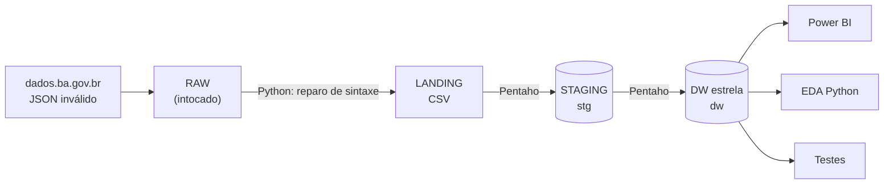

# Bens Imóveis do Estado da Bahia: do dado aberto ao dashboard

Pipeline de dados ponta a ponta sobre o patrimônio imobiliário da administração direta do Estado da Bahia, com dados abertos do
[dados.ba.gov.br](https://dados.ba.gov.br/dataset/bens-imoveis) (SIMOV/SAEB). Projeto do **Bootcamp Amazing Data Intelligence**,
MBA em Ciência e Engenharia de Dados (UNIESP).

**Stack:** Python (ingestão e EDA) · Pentaho Data Integration 9.4 (ETL) · PostgreSQL 16 em Docker (staging + Data Warehouse) ·
Power BI (dashboard).

## O que os dados mostram

> **A Bahia tem R$ 5,5 bilhões em imóveis próprios (6.477 imóveis em 2026), dois terços do valor em Salvador, e 9 em cada 10
> imóveis não têm destinação registrada.**

| Pergunta de negócio | Resposta (exercício 2026) |
|---|---|
| Quanto vale o patrimônio e com quem está? | R$ 5,54 bi. Administração (R$ 923 mi), Saúde (R$ 844 mi) e Educação (R$ 726 mi) lideram; a Educação tem mais imóveis (3.706) |
| Onde estão os imóveis? | Salvador: 11% dos imóveis e 67% do valor. Interior: 86% dos imóveis |
| Os imóveis têm destinação definida? | **91% estão "Não definido"** (95% na Educação, 93% na Saúde) |
| Há patrimônio que pode virar receita? | ≈ R$ 0,66 bi em alienação, projeto de alienação, leilão ou outorga |
| Como o valor evoluiu? | Cada imóvel deprecia cerca de 5% ao ano, mas o total dobrou de 2020 (R$ 2,6 bi) para 2026 por reavaliações e incorporações |
| O cadastro é confiável? | 5.663 registros sem área, 335 sem valor, 1 erro de digitação de R$ 6,8 bi (imóvel 8368 em 2023), valores de 1992-1993 em moeda pré-Real |

Os números saem de [`sql/consultas_analiticas.sql`](sql/consultas_analiticas.sql) e do [notebook de EDA](notebooks/eda_bens_imoveis.ipynb).

## Arquitetura



- **Fato** `dw.fato_patrimonio_anual`: snapshot periódico anual, **grão = 1 imóvel × 1 exercício** (190.544 linhas).
- **Dimensões:** `dim_tempo`, `dim_imovel`, `dim_municipio`, `dim_orgao`, `dim_destino`.
- Detalhes e justificativas: [`docs/arquitetura.md`](docs/arquitetura.md) · Dicionário: [`docs/dicionario_dados.md`](docs/dicionario_dados.md).

## Como rodar do zero

### Pré-requisitos
| Software | Versão testada | Observação |
|---|---|---|
| Git | 2.x | |
| Docker Desktop | 4.x | Sobe o PostgreSQL 16 |
| Python | 3.12 | `pip install -r requirements.txt` |
| Java (OpenJDK) | 11 | Exigido pelo Pentaho |
| Pentaho Data Integration | 9.4 CE | Instalado fora do repositório (padrão: `C:\Pentaho\data-integration`) |
| Power BI Desktop | 2.1xx | Só para o dashboard (Windows) |

### Passo a passo (Windows, PowerShell)

```powershell
# 1. Clonar
git clone https://github.com/nicollasgaribaldi/Dados_Abertos_Bens_Imoveis_Bahia.git
cd Dados_Abertos_Bens_Imoveis_Bahia

# 2. Configurar o ambiente (edite a senha no .env)
Copy-Item .env.example .env
pip install -r requirements.txt

# 3. Subir o PostgreSQL (cria os schemas stg e dw automaticamente)
docker compose up -d

# 4. Rodar o pipeline: ingestão (Python) + job do Pentaho (Kitchen)
powershell -ExecutionPolicy Bypass -File etl\executar_pipeline.ps1
#    (Pentaho em outra pasta? acrescente: -PentahoDir "D:\caminho\data-integration")

# 5. Validar a qualidade dos dados
python tests\rodar_testes.py

# 6. (Opcional) Reexecutar a análise exploratória
jupyter nbconvert --to notebook --execute --inplace notebooks\eda_bens_imoveis.ipynb
```

Resultado esperado: `13/13 testes de integridade aprovados` e 190.544 linhas em `dw.fato_patrimonio_anual`.

**Linux/macOS:** passos 1 a 3 iguais (`cp .env.example .env`). No passo 4, rode `python ingestion/reparar_json.py` e depois
`./kitchen.sh -file=<repo>/etl/job_carga_dw.kjb -param:PG_PASSWORD=<senha>` a partir da pasta do Pentaho.

**Pelo Spoon (interface do Pentaho):** abra `etl/job_carga_dw.kjb`, clique em *Run* e preencha o parâmetro `PG_PASSWORD` com a senha do
`.env` (os demais já têm valor padrão). Rode antes `python ingestion/reparar_json.py`.

### Dashboard
Abra `dashboard/bens_imoveis_ba.pbix` e, em **Transformar dados → Configurações da fonte de dados**, informe a senha do `.env`;
depois clique em **Atualizar**. Como o modelo foi montado, com as medidas DAX: [`dashboard/README.md`](dashboard/README.md).

## Estrutura do repositório

```
├── db_bensimoveis_ba/   RAW: JSON original (intocado), dicionário oficial e links da fonte
├── ingestion/           reparar_json.py: JSON inválido -> JSON válido + CSV (camada landing)
├── etl/                 Pentaho: 01_stg, 02_dimensoes, 03_fato (.ktr), job_carga_dw.kjb, executar_pipeline.ps1
├── sql/ddl/             DDL da staging e do DW (executado na criação do contêiner)
├── sql/                 consultas_analiticas.sql (perguntas de negócio)
├── tests/               testes de qualidade (integridade entre camadas + alertas da fonte)
├── notebooks/           eda_bens_imoveis.ipynb (análise exploratória)
├── dashboard/           .pbix, medidas DAX e prints
├── docs/                arquitetura, modelo dimensional e dicionário de dados
├── docker-compose.yml   PostgreSQL 16
└── .env.example         variáveis de ambiente (copie para .env; o .env não é versionado)
```

`data/processed/` e `logs/` são gerados pelo pipeline e ficam fora do Git.

## Fonte e licença dos dados

Dados abertos do Governo do Estado da Bahia: Sistema de Gestão do Patrimônio Imobiliário (SIMOV), Secretaria da Administração (SAEB),
atualização mensal. Links em [`db_bensimoveis_ba/db_bensimoveis_ba.txt`](db_bensimoveis_ba/db_bensimoveis_ba.txt).
Os valores são **contábeis** (depreciados), não valores de mercado.

## Autor

Nícollas Garibaldi · [github.com/nicollasgaribaldi](https://github.com/nicollasgaribaldi)
