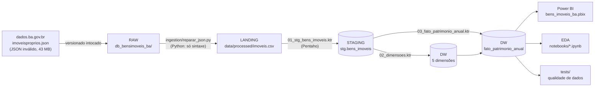
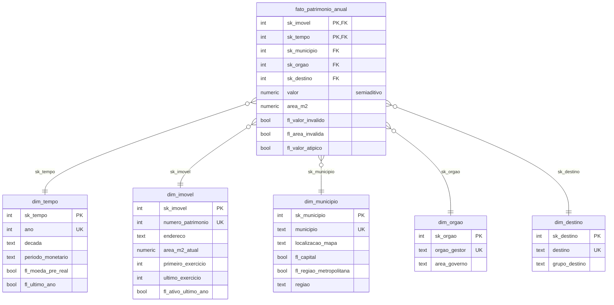

# Arquitetura do pipeline

## Visão ponta a ponta

Orquestração: `etl/job_carga_dw.kjb` (limpa as tabelas → staging → dimensões → fato). O script `etl/executar_pipeline.ps1` roda a
ingestão em Python e depois o job pelo Kitchen, passando as credenciais do `.env` como parâmetros.

| Camada | Onde | O que faz | Por quê |
|---|---|---|---|
| Raw | `db_bensimoveis_ba/imoveisproprios.json` | Arquivo original, nunca alterado | Rastreabilidade: dá para refazer tudo a partir da fonte |
| Landing | `data/processed/` (fora do Git) | JSON reparado + CSV UTF-8 + relatório do reparo | O JSON da fonte é inválido (BOM, 190.544 vírgulas faltando e 190.544 sobrando, 356 vazios). O *JSON Input* do Pentaho não lê; o Python corrige só a sintaxe |
| Staging | `stg.bens_imoveis` | Espelho tipado e padronizado (trim, caixa alta, espaços) | Separa "o que chegou" de "o que foi modelado" e permite testar contagens entre camadas |
| DW | schema `dw` | Estrela: 1 fato + 5 dimensões | Consultas simples e rápidas para o BI |
| Consumo | Power BI (Import) | Dashboard com 4 páginas | Lê só o `dw` |

**Estratégia de carga: full e idempotente.** A fonte publica o arquivo completo todo mês (não há carga incremental na origem), então
o job trunca e recarrega tudo em cerca de 15 segundos. Rodar duas vezes dá o mesmo resultado.

## Modelo dimensional

| Tabela | Linhas | Grão / conteúdo |
|---|---|---|
| `fato_patrimonio_anual` | 190.544 | **1 imóvel em 1 exercício** (snapshot periódico anual) |
| `dim_tempo` | 35 | 1 exercício (1992 a 2026) |
| `dim_imovel` | 6.809 | 1 número de patrimônio, atributos do exercício mais recente |
| `dim_municipio` | 417 | 1 município da Bahia |
| `dim_orgao` | 33 | 1 órgão gestor, agrupado em 7 áreas de governo |
| `dim_destino` | 6 | 1 destino, agrupado em 3 grupos |

## Decisões de modelagem (e como defendê-las)

1. **Grão imóvel × exercício.** É o menor nível da fonte. Agregar antes perderia a análise por imóvel e a auditoria (por exemplo, achar o
   pico de digitação do imóvel 8368).
2. **Snapshot periódico, valor semiaditivo.** O `Exercicio` não é "ano de cadastro", como diz o dicionário da fonte: cada imóvel aparece
   uma vez por ano com o valor daquele ano. Soma-se entre imóveis no mesmo ano, nunca entre anos. No Power BI, as medidas usam o último
   exercício do contexto.
3. **Órgão, destino e município ligados na fato, não na `dim_imovel`.** 571 imóveis trocaram de órgão e 464 de destino ao longo dos anos.
   Ligando por exercício, cada ano guarda a situação daquele ano (o efeito de uma SCD tipo 2, sem versionar a dimensão).
   A `dim_imovel` fica com endereço e área mais recentes (SCD tipo 1).
4. **Chaves substitutas (`sk_*`).** Isolam o DW das chaves da fonte (textos com acento e espaços) e deixam a fato enxuta (inteiros).
5. **Flags em vez de exclusão.** Valores inválidos, áreas inválidas e o pico atípico continuam no DW, marcados. O dado da fonte é
   preservado e cada análise decide o filtro, de forma explícita.
6. **Moeda pré-Real na `dim_tempo`.** 1992 e 1993 estão em Cruzeiro e Cruzeiro Real; o dashboard filtra `periodo_monetario = 'Real'`.
7. **Python só onde o Pentaho não alcança.** O reparo é textual, anterior a qualquer leitura estruturada. Todo o ETL com regra
   (padronização, dimensões, lookups, flags) está no Pentaho, que é o foco da disciplina.

## Segurança e reprodutibilidade

- Nenhuma credencial versionada: os `.ktr`/`.kjb` usam parâmetros `${PG_HOST}`, `${PG_PORT}`, `${PG_DB}`, `${PG_USER}` e
  `${PG_PASSWORD}`, preenchidos pelo `.env` (que está no `.gitignore`; o repositório só tem o `.env.example`).
- Caminhos relativos ao arquivo (`${Internal.Entry.Current.Directory}`): o projeto roda em qualquer pasta.
- O banco nasce pronto: o `docker-compose.yml` monta `sql/ddl/` no `docker-entrypoint-initdb.d`.
- Testes automáticos de integridade entre camadas (`tests/rodar_testes.py`).
